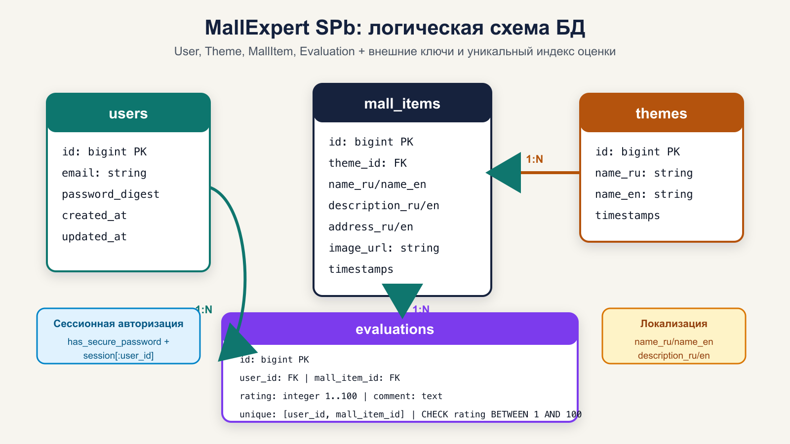
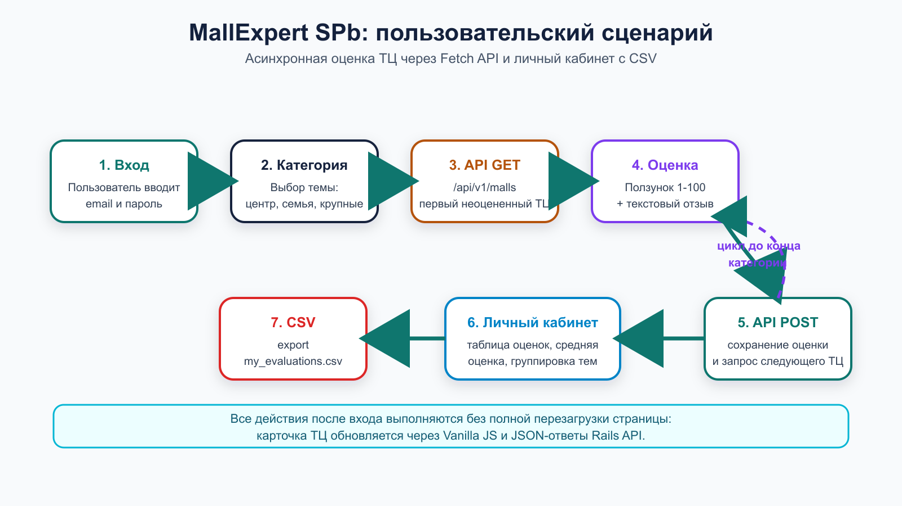
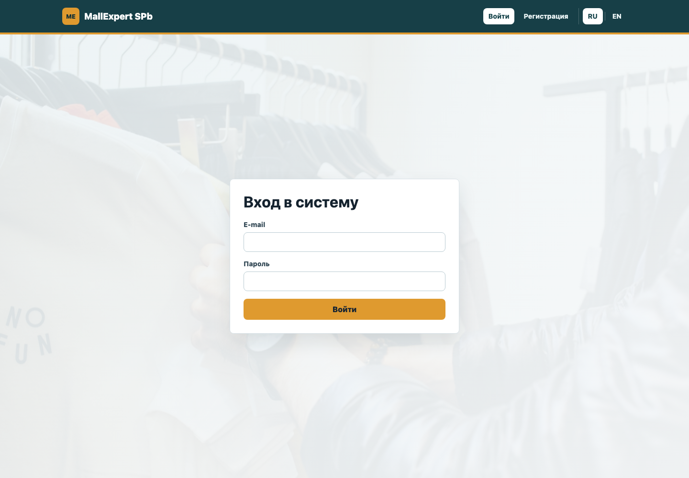
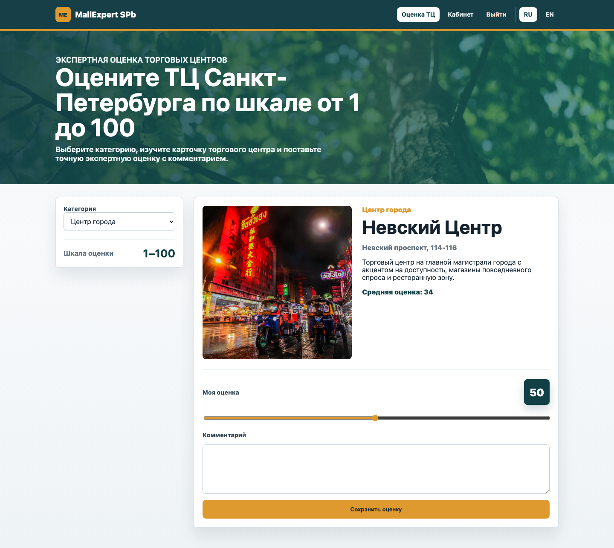
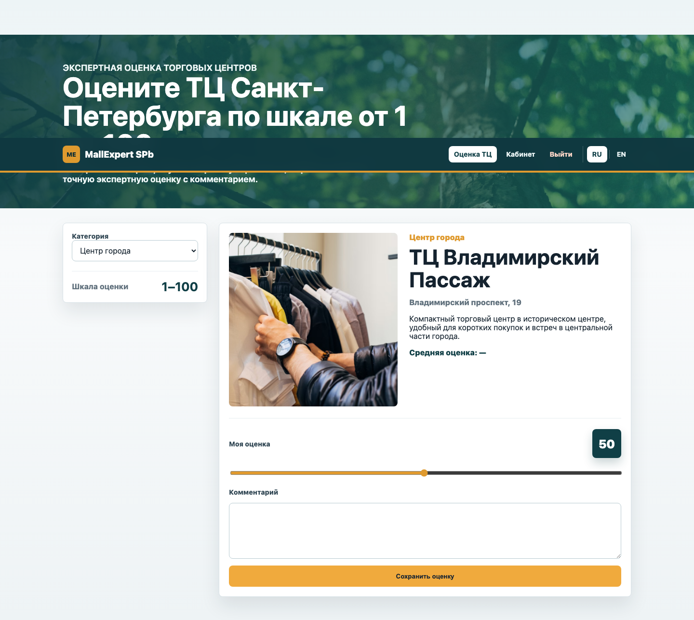
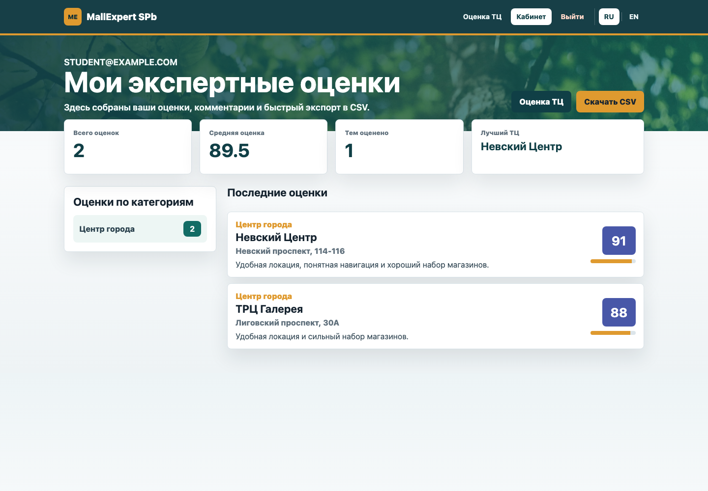
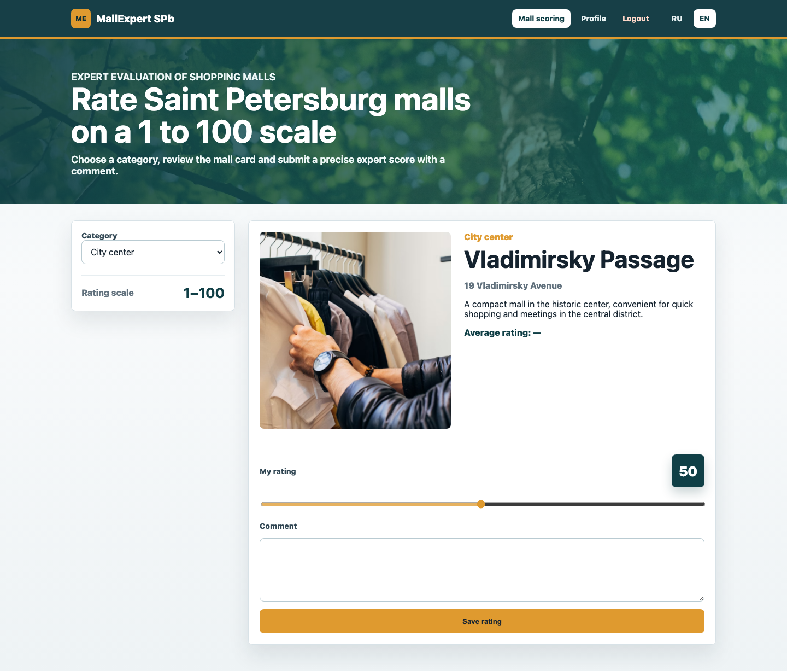

<div class="title-page">

<div>

Санкт-Петербургский политехнический университет Петра Великого  
Институт компьютерных наук и кибербезопасности  
Высшая школа прикладной информатики

</div>

<div>

# КУРСОВОЙ ПРОЕКТ

## Разработка WEB-приложения на Ruby on Rails

по дисциплине «Методики разработки современных WEB-приложений»

</div>

<div>

<p class="right">Выполнил<br>
студент гр. 5140903/50401<br>
<strong>Татарченко Андрей Александрович</strong></p>

<p class="right">Преподаватель<br>
доцент, к.т.н.<br>
<strong>Иванищев Алексей Вячеславович</strong></p>

</div>

<div>

Санкт-Петербург  
2026

</div>

</div>

<div class="page-break"></div>

# ЗАДАНИЕ  
на выполнение курсового проекта

<div class="assignment">

Студенту: **Татарченко Андрей Александрович**  
Группа: **5140903/50401**

1. **Тема курсового проекта:** Разработка WEB-приложения на Ruby on Rails.
2. **Срок сдачи студентом законченной работы:** 25.05.2026.
3. **Исходные данные к работе:** требования дисциплины «Методики разработки современных WEB-приложений»; методические материалы по Ruby on Rails; документация Ruby on Rails 8, PostgreSQL, Active Record, I18n и Fetch API; исходные примеры курсовых проектов; локально разработанное приложение MallExpert SPb.
4. **Содержание пояснительной записки:** введение; постановка задачи и требования; выбор технологий; проектирование MVC-приложения и базы данных; реализация пользовательского интерфейса, сессионной авторизации, API, локализации и CSV-экспорта; тестирование и запуск; результаты работы; заключение; список источников; приложения.
5. **Перечень графического материала:** схема базы данных; схема пользовательского сценария; скриншоты входа, главной рабочей области, оценки ТЦ, личного кабинета и английской локализации; листинги ключевых файлов проекта.
6. **Консультанты:** доцент, к.т.н. Иванищев Алексей Вячеславович.

Дата получения задания: **03.02.2026**

<div class="signature">

<p>Преподаватель<br><br>____________________ / А.В. Иванищев /</p>

<p>Задание принял к исполнению<br><br>____________________ / А.А. Татарченко /<br>Дата: 17.02.2026</p>

</div>

</div>

<div class="page-break"></div>

# Аннотация

В курсовом проекте я разработал WEB-приложение **MallExpert SPb** на фреймворке **Ruby on Rails 8** для экспертной оценки и выбора торговых центров Санкт-Петербурга. Я выбрал предметную область ТЦ и ТРЦ, потому что для нее естественно сравнивать объекты по совокупности признаков: расположение, удобство, торговый состав, семейный досуг и общее качество посещения. В приложении пользователь регистрируется, входит в систему, выбирает категорию торговых центров, получает первую неоцененную карточку и выставляет экспертную оценку плавным интерактивным ползунком от 1 до 100.

В качестве хранилища я использовал PostgreSQL, а серверную часть построил на MVC-архитектуре Rails. Аутентификацию я реализовал вручную через `has_secure_password`, `bcrypt`, `SessionsController` и хранение идентификатора пользователя в `session[:user_id]`. Для динамики интерфейса я написал Vanilla JS-модуль на Fetch API, который получает карточку ТЦ и сохраняет оценку без перезагрузки страницы. Также я реализовал русскую и английскую локализацию, личный кабинет пользователя, расчет средней оценки и экспорт пользовательских оценок в CSV.

<div class="page-break"></div>

# Содержание

1. Введение  
   1.1 Актуальность темы  
   1.2 Цель и задачи моей работы  
   1.3 Объект, предмет и краткое описание проекта  
2. Постановка задачи и требования  
   2.1 Функциональные требования  
   2.2 Нефункциональные требования  
   2.3 Пользовательские сценарии  
3. Выбор технологий и инструментов  
   3.1 Обоснование Ruby on Rails 8  
   3.2 Используемый стек  
4. Проектирование  
   4.1 Архитектура MVC  
   4.2 Маршрутизация  
   4.3 Модель данных  
   4.4 Схема пользовательского сценария  
5. Реализация проекта  
   5.1 Сессионная авторизация  
   5.2 Модели и ограничения данных  
   5.3 Интернационализация RU/EN  
   5.4 API и асинхронный интерфейс  
   5.5 Личный кабинет и CSV-экспорт  
   5.6 Начальные данные  
6. Описание пользовательского интерфейса  
   6.1 Вход и регистрация  
   6.2 Рабочая область эксперта  
   6.3 Личный кабинет  
   6.4 Английская локализация  
7. Тестирование и отладка  
   7.1 Unit-тесты  
   7.2 Интеграционные тесты  
   7.3 Smoke-test  
8. Запуск и развертывание  
   8.1 Локальный запуск  
   8.2 Docker-запуск  
9. Результаты моей работы  
10. Заключение  
11. Список использованных источников  
12. Приложения

<div class="page-break"></div>

## 1. Введение

### 1.1 Актуальность темы

Современные WEB-приложения часто решают задачу экспертного выбора: пользователь не просто просматривает объект, а последовательно оценивает его по заданной шкале, накапливает персональную статистику и получает возможность вернуться к результатам. Такой подход используется в рекомендательных системах, сервисах отзывов, образовательных тренажерах и внутренних корпоративных инструментах. Я выбрал эту идею как основу курсового проекта, потому что она позволяет показать полный цикл разработки: от проектирования структуры данных до динамического интерфейса и сохранения результатов в базе.

Предметной областью моей работы стали торговые центры Санкт-Петербурга. В отличие от абстрактных карточек или простых изображений, ТЦ имеют понятные пользователю характеристики: адрес, назначение, формат посещения, развлекательная инфраструктура, удобство для семейного досуга и масштаб комплекса. Поэтому оценка торговых центров хорошо подходит для демонстрации экспертной системы: пользователь может сравнивать реальные объекты и фиксировать собственное мнение.

Отдельно я сделал акцент на шкале оценки от 1 до 100. В примерах лабораторных и курсовых работ часто встречается дискретная шкала 1-5 или 1-10, но она грубая: оценка 4 и 5 не дает пространства для более точного экспертного различия. В моем приложении я использовал HTML5 `range`, похожий по ощущению на интерактивные стикеры-опросы в социальных сетях. Такой ползунок позволяет быстро поставить не только условные «хорошо» или «отлично», но и более точную оценку, например 76, 88 или 94 балла.

### 1.2 Цель и задачи моей работы

Цель моей работы - разработать WEB-приложение на Ruby on Rails 8 и PostgreSQL для экспертной оценки торговых центров Санкт-Петербурга с асинхронным интерфейсом, ручной сессионной авторизацией, локализацией и экспортом результатов.

Для достижения цели я поставил и выполнил следующие задачи:

- спроектировал структуру проекта на Ruby on Rails 8;
- настроил подключение PostgreSQL и миграции базы данных;
- разработал модели `User`, `Theme`, `MallItem` и `Evaluation`;
- реализовал ручную регистрацию и вход через `has_secure_password`;
- настроил маршрутизацию с локалью `/:locale` для страниц и отдельный JSON API;
- сделал рабочую область, где пользователь выбирает тему и получает первый неоцененный ТЦ;
- реализовал плавный ползунок оценки от 1 до 100 и сохранение комментария;
- добавил личный кабинет с таблицей оценок, средним значением и группировкой по темам;
- реализовал выгрузку персональных оценок в `my_evaluations.csv`;
- подготовил демо-данные на 10 реальных ТЦ Санкт-Петербурга;
- написал тесты для моделей и интеграционного пользовательского сценария;
- подготовил Dockerfile, инструкции запуска, скриншоты и итоговую пояснительную записку.

### 1.3 Объект, предмет и краткое описание проекта

Объектом моей работы является процесс разработки современных WEB-приложений на MVC-фреймворках. Предметом работы является реализация экспертной системы оценки объектов на Ruby on Rails с серверной логикой, клиентской динамикой, хранением данных и локализацией интерфейса.

Итоговое приложение получило название **MallExpert SPb**. Пользователь заходит на сайт, создает учетную запись или использует демо-пользователя, выбирает категорию торговых центров и начинает оценку. Сервер выдает первый торговый центр из выбранной категории, который еще не оценен текущим пользователем. После сохранения оценки система сразу запрашивает следующий объект. Когда все ТЦ в категории оценены, пользователь получает сообщение о завершении.

Я сделал приложение не как статическую демонстрацию, а как законченный учебный продукт: в нем есть база данных, миграции, сиды, авторизация, валидации, API, JavaScript, локализация, тесты, Dockerfile и полный отчет. Такой состав соответствует задаче курсового проекта: показать, что разработчик умеет собрать WEB-систему целиком, а не только отдельные страницы.

## 2. Постановка задачи и требования

### 2.1 Функциональные требования

В начале работы я сформулировал набор функциональных требований, которые должны были быть проверяемыми по коду и по интерфейсу.

| N | Требование | Реализация в проекте |
|---|---|---|
| 1 | Пользователь может зарегистрироваться по e-mail и паролю | `UsersController`, `has_secure_password`, форма `users/new` |
| 2 | Пользователь может войти и выйти из системы | `SessionsController`, `session[:user_id]`, кнопка выхода |
| 3 | Неавторизованный пользователь не может пользоваться рабочей областью | `ApplicationController#authorize` |
| 4 | Пользователь выбирает категорию ТЦ | `Theme`, селект на странице `malls/index` |
| 5 | Система выдает первый неоцененный ТЦ в категории | `Api::V1::MallsApiController#index` |
| 6 | Пользователь ставит оценку от 1 до 100 | `input type="range"`, модель `Evaluation` |
| 7 | Пользователь оставляет текстовый комментарий | поле `comment` в форме и БД |
| 8 | Сохранение оценки выполняется без перезагрузки страницы | `fetch()` в `malls_evaluation.js` |
| 9 | Пользователь видит личный кабинет с оценками | `ProfilesController#show` |
| 10 | Пользователь может выгрузить оценки в CSV | `ProfilesController#export`, `Evaluation.to_csv` |
| 11 | Интерфейс поддерживает русский и английский языки | `config/locales/ru.yml`, `config/locales/en.yml` |

Особенно важным требованием я считал уникальность оценки: один пользователь должен иметь только одну запись `Evaluation` для одного ТЦ. Это требование я закрепил сразу на двух уровнях: валидацией Active Record и уникальным индексом базы данных.

### 2.2 Нефункциональные требования

Нефункциональные требования определяют не отдельные кнопки, а качество готового приложения. Я выделил следующие критерии:

- **надежность данных:** оценки должны сохраняться в PostgreSQL, а диапазон `1..100` должен контролироваться приложением и базой;
- **безопасность:** пароли нельзя хранить в открытом виде, поэтому я использовал `bcrypt` и `password_digest`;
- **удобство интерфейса:** основной сценарий оценки должен выполняться без полной перезагрузки страницы;
- **расширяемость:** предметную область можно расширить новыми категориями и торговыми центрами через сиды или админский слой;
- **локализация:** пользователь должен иметь доступ к русской и английской версии интерфейса;
- **воспроизводимость:** проект должен запускаться локально по инструкции и в Docker-контейнере;
- **проверяемость:** в проекте должны быть тесты, которые подтверждают модельные ограничения и API-сценарий.

Я также учитывал учебное требование: структура проекта должна быть понятной преподавателю при проверке. Поэтому я придерживался стандартного расположения Rails-файлов, не прятал бизнес-логику в нестандартные папки и оставил ключевые решения в контроллерах, моделях и JavaScript-файле, которые легко открыть.

### 2.3 Пользовательские сценарии

Основной сценарий я построил так:

1. пользователь открывает `/ru/login` или `/en/login`;
2. вводит e-mail и пароль;
3. попадает в рабочую область оценки;
4. выбирает категорию торговых центров;
5. получает карточку ТЦ с названием, адресом, описанием, изображением и средней оценкой;
6. выбирает значение на шкале `1..100`;
7. при необходимости пишет комментарий;
8. отправляет оценку;
9. система сохраняет запись и показывает следующий неоцененный ТЦ;
10. пользователь открывает личный кабинет и выгружает CSV.

В этой последовательности я отделил HTML-страницы от API. Страница рабочей области рендерится один раз, а карточки и оценки обрабатываются через JSON. Такой подход делает интерфейс быстрее и демонстрирует современную модель взаимодействия браузера и Rails-сервера.

## 3. Выбор технологий и инструментов

### 3.1 Обоснование Ruby on Rails 8

Ruby on Rails я выбрал как основной фреймворк, потому что он хорошо подходит для учебного проекта полного цикла. Rails сразу задает архитектуру MVC, предоставляет маршрутизацию, миграции, ORM Active Record, шаблонизатор ERB, работу с сессиями, защиту CSRF, тестовый фреймворк и средства локализации. Это позволило мне сосредоточиться на предметной области, а не писать инфраструктурный код с нуля.

Версия Rails 8 важна тем, что она отражает современное состояние фреймворка. В проекте я использовал стандартный набор Rails-компонентов: контроллеры, модели, представления, миграции, `routes.rb`, `config/locales`, импорт JavaScript через importmap и ассеты через Propshaft. Для базы данных я выбрал PostgreSQL, потому что он широко применяется в production-проектах и поддерживает надежные ограничения на уровне схемы.

Я сознательно не использовал Devise, хотя он часто встречается в Rails-проектах. По промту требовалась кастомная авторизация, поэтому я реализовал ее вручную. Это полезно для курсового проекта: в отчете можно показать, как именно создается пользователь, как проверяется пароль, как в сессии хранится идентификатор и как защищаются страницы.

### 3.2 Используемый стек

| Компонент | Назначение |
|---|---|
| Ruby 3.3.11 | язык разработки серверной части |
| Ruby on Rails 8.0 | MVC-фреймворк приложения |
| PostgreSQL 16 | основная СУБД |
| Active Record | ORM, миграции, валидации и связи моделей |
| bcrypt | безопасное хеширование паролей |
| ERB | серверные HTML-шаблоны |
| Vanilla JavaScript | динамика рабочей области |
| Fetch API | обмен JSON между клиентом и сервером |
| I18n | русская и английская локализация |
| Minitest | unit и integration-тесты |
| Docker | воспроизводимый запуск приложения |

Этот стек я считаю достаточным для курсового проекта: он не перегружен лишними зависимостями, но покрывает все требования. Важным техническим решением стало использование Rails API-эндпоинтов внутри обычного MVC-приложения. Так я сохранил простую серверную структуру и одновременно сделал современный асинхронный UX.

<div class="page-break"></div>

## 4. Проектирование

### 4.1 Архитектура MVC

Я спроектировал приложение по стандартному паттерну MVC:

- **Model** отвечает за данные, связи, валидации и вычисления. В проекте это `User`, `Theme`, `MallItem`, `Evaluation`;
- **View** отвечает за HTML-страницы: общий layout, формы входа и регистрации, рабочую область оценки, личный кабинет;
- **Controller** принимает запросы, готовит данные и возвращает HTML или JSON. В проекте есть обычные контроллеры страниц и отдельный API-контроллер.

Разделение получилось следующим:

| Слой | Файлы | Ответственность |
|---|---|---|
| Модели | `app/models/*.rb` | структура данных, связи, валидации, CSV |
| Контроллеры страниц | `malls_controller.rb`, `users_controller.rb`, `sessions_controller.rb`, `profiles_controller.rb` | HTML-страницы и пользовательские сессии |
| API | `app/controllers/api/v1/malls_api_controller.rb` | JSON-выдача ТЦ и сохранение оценки |
| Представления | `app/views/...` | формы, рабочая область, личный кабинет |
| JavaScript | `app/javascript/malls_evaluation.js` | динамическая загрузка карточки и отправка оценки |
| Локализация | `config/locales/ru.yml`, `config/locales/en.yml` | текст интерфейса на двух языках |

В результате архитектура осталась простой. Мне не пришлось вводить сервисные объекты или отдельную frontend-сборку: для размера курсового проекта достаточно стандартных Rails-слоев.

### 4.2 Маршрутизация

Маршруты я разделил на две группы. HTML-страницы обернуты в `scope "(:locale)", locale: /ru|en/`, чтобы пользователь мог открыть `/ru`, `/en`, `/ru/profile`, `/en/profile` и другие локализованные адреса. API вынесен в пространство имен `/api/v1`, потому что JSON-эндпоинты не являются обычными страницами.

| URL | Метод | Контроллер | Назначение |
|---|---|---|---|
| `/ru` или `/en` | GET | `MallsController#index` | рабочая область оценки |
| `/ru/malls` | GET | `MallsController#index` | явный путь к рабочей области |
| `/ru/signup` | GET/POST | `UsersController` | регистрация пользователя |
| `/ru/login` | GET/POST | `SessionsController` | форма входа и создание сессии |
| `/ru/logout` | DELETE | `SessionsController#destroy` | выход из системы |
| `/ru/profile` | GET | `ProfilesController#show` | личный кабинет |
| `/ru/profile/export` | GET | `ProfilesController#export` | скачивание CSV |
| `/api/v1/malls?theme_id=1` | GET | `Api::V1::MallsApiController#index` | получить первый неоцененный ТЦ |
| `/api/v1/malls` | POST | `Api::V1::MallsApiController#create` | сохранить оценку и комментарий |

Листинг маршрутов приведен ниже. Я включил его полностью, потому что по нему удобно проверить соответствие проекта требованиям.

```ruby
{{include:config/routes.rb}}
```

### 4.3 Модель данных

Я разработал четыре основные сущности.

| Таблица | Назначение | Ключевые поля |
|---|---|---|
| `users` | пользователи системы | `email`, `password_digest` |
| `themes` | категории торговых центров | `name_ru`, `name_en` |
| `mall_items` | карточки ТЦ/ТРЦ | `name_ru`, `name_en`, `description_ru`, `description_en`, `address_ru`, `address_en`, `image_url`, `theme_id` |
| `evaluations` | экспертные оценки пользователей | `user_id`, `mall_item_id`, `rating`, `comment` |

Связи моделей:

- `User has_many :evaluations`;
- `Theme has_many :mall_items`;
- `MallItem belongs_to :theme`;
- `MallItem has_many :evaluations`;
- `Evaluation belongs_to :user`;
- `Evaluation belongs_to :mall_item`.

Для таблицы `evaluations` я сделал уникальный индекс на пару `user_id + mall_item_id`. Это не позволяет одному пользователю создать дубликаты оценок для одного торгового центра. Также в миграции я добавил check constraint на диапазон `rating BETWEEN 1 AND 100`. Даже если кто-то обойдет интерфейс и отправит неверное значение напрямую в API, база не примет некорректную оценку.

<figure>
  
  <figcaption>Рисунок 1 - разработанная мной логическая схема базы данных MallExpert SPb.</figcaption>
</figure>

### 4.4 Схема пользовательского сценария

Я спроектировал пользовательский сценарий как цикл экспертной оценки. Пользователь выбирает тему, получает карточку, оценивает ее, а затем система автоматически выдает следующий неоцененный объект. Такой сценарий хорошо подходит для набора экспертных данных: пользователь не тратит время на ручной выбор каждой карточки.

<figure>
  
  <figcaption>Рисунок 2 - пользовательский поток: вход, выбор категории, API, оценка, личный кабинет и CSV.</figcaption>
</figure>

<div class="page-break"></div>

## 5. Реализация проекта

### 5.1 Сессионная авторизация

Аутентификацию я реализовал без Devise. В модели `User` я использовал `has_secure_password`, который добавляет методы установки пароля, подтверждения пароля и проверки пароля через `authenticate`. Для работы этого механизма в Gemfile подключен `bcrypt`, а в таблице `users` создано поле `password_digest`.

В `SessionsController#create` я ищу пользователя по e-mail и вызываю `user.authenticate(params[:password])`. Если пароль верный, я сохраняю `user.id` в `session[:user_id]`. После этого helper `current_user` в `ApplicationController` может восстановить пользователя для каждого следующего запроса. Метод `authorize` защищает рабочую область, личный кабинет и API: HTML-запросы перенаправляются на страницу входа, а JSON-запросы получают ответ `401 Unauthorized`.

Такой вариант авторизации проще Devise, но для учебного проекта он даже полезнее: я явно показываю, как устроен вход, выход и проверка прав. При этом пароль не хранится в открытом виде, потому что `bcrypt` сохраняет только безопасный хеш.

### 5.2 Модели и ограничения данных

Самая важная бизнес-модель проекта - `Evaluation`. В ней я закрепил диапазон оценки, связь с пользователем и торговым центром, ограничение длины комментария и уникальность пары `user_id + mall_item_id`. Также в этой модели я реализовал экспорт в CSV.

```ruby
{{include:app/models/evaluation.rb}}
```

Модель `MallItem` содержит методы локализованного вывода: `localized_name`, `localized_description`, `localized_address`. Благодаря этому контроллер и представление не решают каждый раз, какое поле выбрать. Еще в модели есть метод `average_rating`, который считает среднюю экспертную оценку и округляет ее до двух знаков. Это значение я показываю в карточке ТЦ.

Для надежности я продублировал критичные правила в миграции. Валидации удобны для пользовательских ошибок, но ограничения базы данных защищают от прямых вставок и случайных багов. Поэтому `evaluations` имеет внешний ключ на пользователя, внешний ключ на ТЦ, уникальный индекс и check constraint.

### 5.3 Интернационализация RU/EN

Локализацию я сделал через стандартный Rails I18n. В `ApplicationController#set_locale` я беру язык из `params[:locale]`, проверяю, что он входит в список доступных локалей, и сохраняю его в сессии. В layout есть ссылки `RU` и `EN`, которые меняют текущий путь с другим параметром локали.

Отдельно я локализовал не только статический интерфейс, но и данные предметной области. В `themes` хранятся `name_ru` и `name_en`, а в `mall_items` - русские и английские названия, адреса и описания. Поэтому английская версия страницы показывает не просто переведенные кнопки, а полноценную карточку ТЦ на английском языке.

### 5.4 API и асинхронный интерфейс

API-контроллер я вынес в `app/controllers/api/v1/malls_api_controller.rb`. Метод `index` принимает `theme_id`, находит все ТЦ выбранной темы, сравнивает их с оценками текущего пользователя и возвращает первый неоцененный объект. Если все объекты уже оценены, API возвращает `done: true` и сообщение для интерфейса.

Метод `create` принимает `mall_item_id`, `rating` и `comment`. Я использую `find_or_initialize_by`, поэтому повторная отправка оценки для той же пары пользователя и ТЦ не создает дубль, а обновляет существующую запись. Это решение согласуется с уникальным индексом и делает API устойчивее.

```ruby
{{include:app/controllers/api/v1/malls_api_controller.rb}}
```

На клиентской стороне я написал отдельный JavaScript-файл `malls_evaluation.js`. Он слушает событие `turbo:load`, находит элементы рабочей области, обрабатывает смену категории, обновляет значение ползунка и отправляет форму через `fetch()`. CSRF-токен берется из meta-тега layout, поэтому POST-запросы проходят стандартную Rails-защиту.

```javascript
{{include:app/javascript/malls_evaluation.js}}
```

### 5.5 Личный кабинет и CSV-экспорт

Личный кабинет я реализовал в `ProfilesController#show`. На странице пользователь видит общее количество оценок, среднюю оценку, количество оцененных тем и таблицу всех оценок. Данные загружаются через `includes(mall_item: :theme)`, чтобы избежать лишних запросов к базе при выводе связанных объектов.

Экспорт я сделал через стандартную библиотеку Ruby `CSV`. Метод `Evaluation.to_csv` формирует файл с заголовками и строками оценок. В контроллере я вызываю `send_data`, задаю имя `my_evaluations.csv` и MIME-тип `text/csv`. Такой экспорт удобен для дальнейшего анализа в Excel, Google Sheets или другой системе.

### 5.6 Начальные данные

В `db/seeds.rb` я добавил три категории и десять реальных торговых центров Санкт-Петербурга. Категории отражают разные сценарии посещения: центр города, семейный досуг и крупные комплексы. Для каждого ТЦ я указал русское и английское название, адрес, описание и URL изображения.

Я также создал демо-пользователя `student@example.com` с паролем `password123`, чтобы преподаватель мог быстро войти в систему и проверить основной сценарий без ручной регистрации. При этом регистрация в интерфейсе тоже работает.

## 6. Описание пользовательского интерфейса

### 6.1 Вход и регистрация

Страница входа выполнена в спокойной рабочей стилистике. Пользователь видит поля e-mail и пароль, а после успешного входа попадает в рабочую область. Я не перегружал экран декоративными блоками, потому что для учебного экспертного инструмента важнее ясность формы и быстрый доступ к сценарию оценки.

<figure>
  
  <figcaption>Рисунок 3 - страница входа в MallExpert SPb.</figcaption>
</figure>

### 6.2 Рабочая область эксперта

Главный экран приложения состоит из двух частей: панели выбора категории и карточки торгового центра. Центральным элементом я сделал шкалу `1-100`, где пользователь двигает ползунок и сразу видит выбранное число. Под шкалой находится поле комментария и кнопка сохранения.

<figure>
  
  <figcaption>Рисунок 4 - рабочая область на русском языке с карточкой ТРЦ «Галерея».</figcaption>
</figure>

После сохранения оценки интерфейс без перезагрузки запрашивает следующий ТЦ. Это видно по тому, что карточка меняется, а пользователь остается в том же рабочем контексте. Такой UX соответствует требованию Fetch API и делает процесс оценки быстрым.

<figure>
  
  <figcaption>Рисунок 5 - состояние рабочей области после сохранения оценки и перехода к следующему объекту.</figcaption>
</figure>

### 6.3 Личный кабинет

В личном кабинете я вывел агрегаты и таблицу. Пользователь видит, сколько объектов он оценил, какова средняя оценка и в каких темах уже есть результаты. Ниже расположена таблица с ТЦ, темой, оценкой и комментарием. Кнопка «Скачать CSV» позволяет выгрузить эти данные.

<figure>
  
  <figcaption>Рисунок 6 - личный кабинет пользователя с оценками и экспортом CSV.</figcaption>
</figure>

### 6.4 Английская локализация

Английская локализация проверяет сразу две части проекта: маршрутизацию с `/:locale` и данные с полями `*_en`. В английской версии меняются навигация, заголовки, подписи формы, категории и описания торговых центров.

<figure>
  
  <figcaption>Рисунок 7 - английская версия рабочей области MallExpert SPb.</figcaption>
</figure>

<div class="page-break"></div>

## 7. Тестирование и отладка

### 7.1 Unit-тесты

Я написал unit-тесты для ключевых моделей. Для `Evaluation` проверяется диапазон оценки: значения меньше 1 и больше 100 должны быть невалидными. Также проверяется уникальность пары пользователь-ТЦ и генерация CSV. Для `MallItem` проверяется расчет средней оценки, потому что это значение используется в карточке ТЦ.

Такой набор тестов покрывает критичную бизнес-логику. Если в будущем изменить модель оценки, тесты сразу покажут, что нарушился диапазон, уникальность или расчет среднего значения.

### 7.2 Интеграционные тесты

Интеграционный тест проверяет пользовательский путь: вход, открытие рабочей области, запрос к API и сохранение оценки. Я считаю этот тест важным, потому что именно он связывает сессии, контроллеры, маршруты, модели и JSON-ответы. Unit-тесты проверяют детали, а integration-тест подтверждает, что приложение работает как система.

### 7.3 Smoke-test

После сборки я выполнил smoke-test в браузере:

```text
1. Открыл http://localhost:3000/ru/login.
2. Вошел под student@example.com / password123.
3. Выбрал категорию «Центр города».
4. Получил карточку ТРЦ «Галерея».
5. Поставил оценку 88 и добавил комментарий.
6. Убедился, что система показала следующую карточку.
7. Открыл личный кабинет и проверил наличие оценки.
8. Переключил интерфейс на английский язык.
9. Проверил, что локализованные тексты и данные отображаются корректно.
```

## 8. Запуск и развертывание

### 8.1 Локальный запуск

Для локального запуска проекта я подготовил стандартную последовательность команд:

```bash
cd /Users/doodels/.openclaw/workspace/projects/fooddecision-course
cp .env.example .env
bundle install
bin/rails db:create db:migrate db:seed
bin/rails server
```

После запуска приложение доступно по адресам:

- `http://localhost:3000/ru`;
- `http://localhost:3000/en`.

Демо-пользователь:

```text
email: student@example.com
password: password123
```

### 8.2 Docker-запуск

Для воспроизводимого запуска я подготовил Dockerfile. Контейнер можно собрать и запустить командой:

```bash
docker build -t mall-expert-course .
docker run --rm -p 3000:3000 \
  -e RAILS_ENV=development \
  -e POSTGRES_HOST=host.docker.internal \
  -e POSTGRES_USER=postgres \
  -e POSTGRES_PASSWORD=postgres \
  -e POSTGRES_DB=mall_expert_course_development \
  mall-expert-course \
  ./bin/rails server -b 0.0.0.0 -p 3000
```

Такой способ удобен для переноса проекта на другое устройство: достаточно иметь Docker и доступную PostgreSQL-базу.

## 9. Результаты моей работы

В результате выполнения курсового проекта я получил работающее WEB-приложение MallExpert SPb. Я реализовал полный пользовательский сценарий экспертной оценки торговых центров: вход, выбор категории, получение карточки, оценка ползунком 1-100, комментарий, сохранение результата, переход к следующему объекту и просмотр персональных оценок в личном кабинете.

По требованиям промта я выполнил следующие пункты:

| Требование | Статус | Где проверять |
|---|---|---|
| Rails 8 + PostgreSQL | выполнено | `Gemfile`, `config/database.yml` |
| Кастомная авторизация | выполнено | `User`, `SessionsController`, `ApplicationController` |
| `has_secure_password` и `bcrypt` | выполнено | `app/models/user.rb`, `Gemfile` |
| Модели `User`, `Theme`, `MallItem`, `Evaluation` | выполнено | `app/models` |
| Оценка 1-100 | выполнено | `Evaluation`, миграция, JS-ползунок |
| Уникальный индекс оценки | выполнено | `db/schema.rb`, миграция `create_evaluations` |
| Fetch API | выполнено | `app/javascript/malls_evaluation.js` |
| API `/api/v1/malls` | выполнено | `MallsApiController` |
| Личный кабинет | выполнено | `ProfilesController#show` |
| CSV-экспорт | выполнено | `ProfilesController#export`, `Evaluation.to_csv` |
| RU/EN локализация | выполнено | `config/locales` |
| 10 ТЦ по 3 категориям | выполнено | `db/seeds.rb` |
| Тесты | выполнено | `test/models`, `test/integration` |
| Отчет и скриншоты | выполнено | `report`, `screens` |

Проект можно использовать как основу для дальнейшего развития. Например, можно добавить роли администратора, редактирование списка торговых центров через интерфейс, расширенную аналитику по оценкам или фильтрацию по району города. Но базовая версия уже решает поставленную учебную задачу и демонстрирует основные навыки разработки Rails-приложений.

## 10. Заключение

В ходе выполнения курсового проекта я спроектировал и разработал полноценное WEB-приложение на Ruby on Rails 8. Я прошел весь путь от постановки задачи и структуры базы данных до реализации интерфейса, API, тестов, Docker-запуска и пояснительной записки.

Главным техническим результатом для меня стала реализация связки Rails MVC + Fetch API. Серверная часть отвечает за надежное хранение данных и проверку правил, а клиентская часть делает основной сценарий быстрым и удобным. Отдельно я закрепил понимание ручной сессионной авторизации: в проекте нет Devise, поэтому весь процесс входа и защиты маршрутов реализован явно.

Я также убедился, что Rails 8 остается удобной экосистемой для учебных и прикладных WEB-проектов. Фреймворк позволяет быстро собрать приложение, но при этом не мешает контролировать важные детали: маршруты, валидации, SQL-ограничения, локализацию и формат API.

Итоговая версия MallExpert SPb соответствует требованиям промта: предметная область перенесена на торговые центры Санкт-Петербурга, используется шкала 1-100, реализованы кастомные сессии, PostgreSQL, JSON API, личный кабинет, CSV-экспорт, RU/EN локализация, тесты и отчетные материалы.

## 11. Список использованных источников

1. Ruby on Rails Guides. Официальная документация Ruby on Rails. URL: https://guides.rubyonrails.org/
2. Ruby on Rails API Documentation. URL: https://api.rubyonrails.org/
3. PostgreSQL Documentation. URL: https://www.postgresql.org/docs/
4. Ruby CSV Documentation. URL: https://ruby-doc.org/stdlib/libdoc/csv/rdoc/CSV.html
5. MDN Web Docs: Fetch API. URL: https://developer.mozilla.org/en-US/docs/Web/API/Fetch_API
6. MDN Web Docs: HTML input range. URL: https://developer.mozilla.org/en-US/docs/Web/HTML/Element/input/range
7. Rails Internationalization Guide. URL: https://guides.rubyonrails.org/i18n.html
8. Docker Documentation. URL: https://docs.docker.com/

<div class="page-break"></div>

## 12. Приложения

### Приложение А. Структура проекта

Ключевые файлы итогового проекта:

| Файл | Назначение |
|---|---|
| `Gemfile` | зависимости Rails 8, PostgreSQL, bcrypt, importmap, propshaft |
| `config/routes.rb` | маршруты HTML-страниц и JSON API |
| `app/controllers/application_controller.rb` | локализация, текущий пользователь, защита маршрутов |
| `app/controllers/api/v1/malls_api_controller.rb` | получение ТЦ и сохранение оценки |
| `app/models/evaluation.rb` | валидации оценки, уникальность, CSV |
| `app/javascript/malls_evaluation.js` | динамический интерфейс оценки |
| `db/seeds.rb` | три категории и десять ТЦ Санкт-Петербурга |
| `test/integration/mall_workflow_test.rb` | проверка пользовательского сценария |

### Приложение Б. Листинг `Gemfile`

```ruby
{{include:Gemfile}}
```

### Приложение В. Листинг модели `MallItem`

```ruby
{{include:app/models/mall_item.rb}}
```

### Приложение Г. Листинг `ApplicationController`

```ruby
{{include:app/controllers/application_controller.rb}}
```

### Приложение Д. Листинг `ProfilesController`

```ruby
{{include:app/controllers/profiles_controller.rb}}
```

### Приложение Е. Листинг теста пользовательского сценария

```ruby
{{include:test/integration/mall_workflow_test.rb}}
```

### Приложение Ж. Команды проверки

```bash
docker build -t mall-expert-course-local .
docker run --rm \
  -e RAILS_ENV=test \
  -e POSTGRES_HOST=host.docker.internal \
  -e POSTGRES_USER=postgres \
  -e POSTGRES_PASSWORD=postgres \
  -e POSTGRES_DB=mall_expert_course_test \
  mall-expert-course-local ./bin/rails db:create db:migrate test
```

### Приложение З. Скриншоты

В папке `screens/` находятся изображения, использованные в отчете:

- `mall_login.png` - страница входа;
- `mall_work_ru.png` - рабочая область на русском языке;
- `mall_after_rating.png` - состояние после сохранения оценки;
- `mall_profile.png` - личный кабинет;
- `mall_work_en.png` - английская локализация;
- `mall_schema_erd.png` - схема базы данных;
- `mall_flow.png` - пользовательский сценарий.

